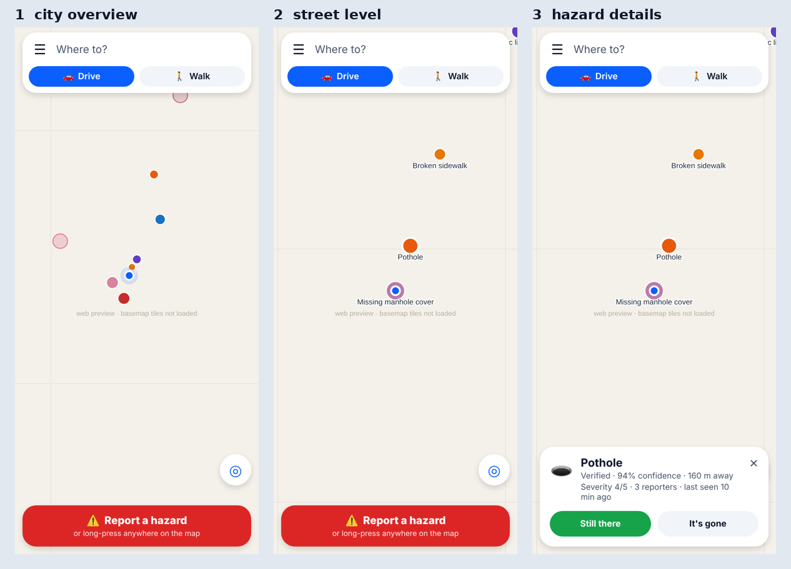
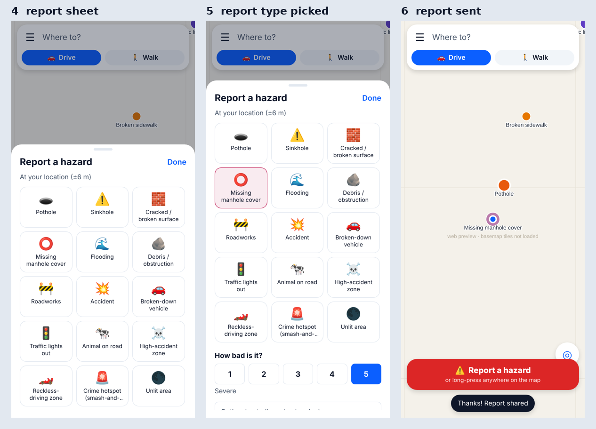
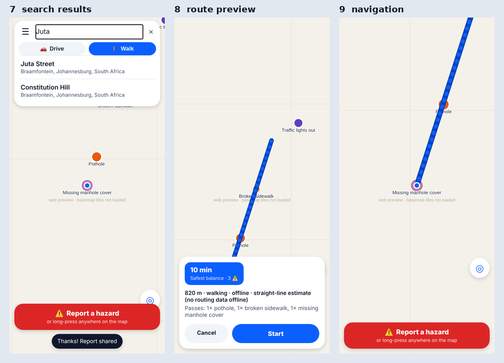
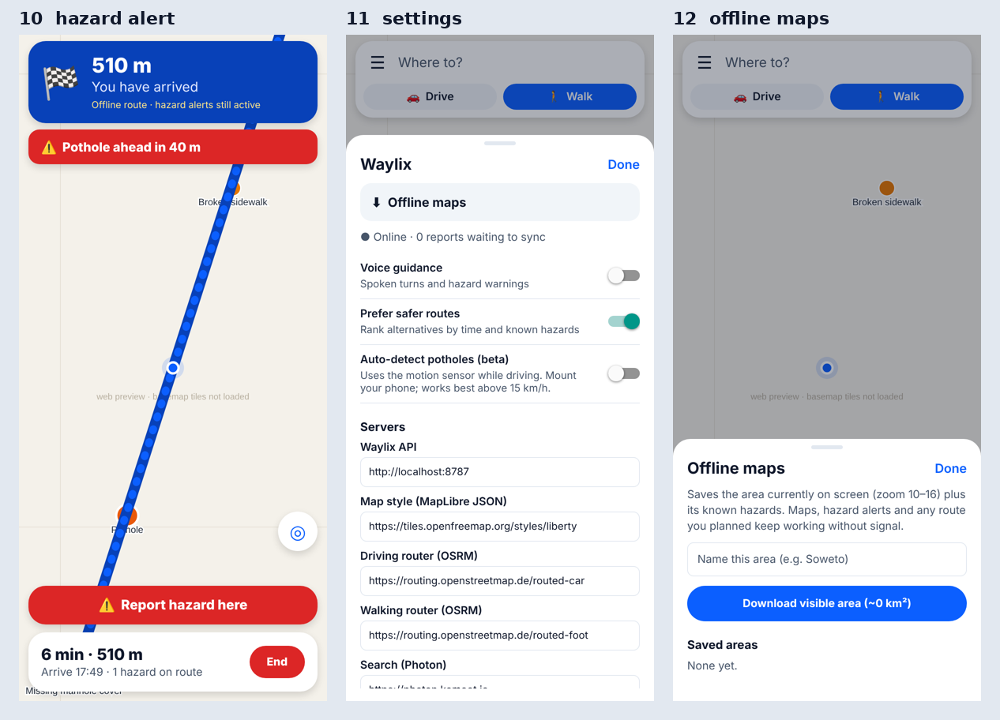

# Waylix — by AIDotLix

**Every road remembers.** Waylix is a free, offline-capable map and navigation app for Android and iOS. Drivers and pedestrians use it to map and report road hazards: potholes, sinkholes, missing manhole covers, flooding, traffic-light outages, accidents, high-accident zones, reckless-driving zones and more.

All of it runs on the **Waylix Hazard Fusion Engine (HFE)**, a platform-agnostic geospatial event engine. The same code runs on the phone (offline) and on the server, and drones can use it today through a built-in adapter.

📄 White paper — *Every Road Remembers: Can Crowd-Sensed Road Hazards Ground Outdoor AR? (with a VPS outlook)*: [Markdown](docs/WHITEPAPER.md) · [PDF](docs/Waylix_White_Paper_AIDotLix.pdf) · [Word](docs/Waylix_White_Paper_AIDotLix.docx)

```
┌──────────────┐  ┌──────────────┐  ┌──────────────┐
│ Phone (walk) │  │ Phone (drive)│  │ Drone camera │   …future: dashcams, municipal feeds
└──────┬───────┘  └──────┬───────┘  └──────┬───────┘
       │ manual / accelerometer / vision → Observation (one schema)
       ▼                  ▼                  ▼
┌────────────────────────────────────────────────────────────┐
│          @waylix/engine — Hazard Fusion Engine              │
│  taxonomy · geohash index · Bayesian log-odds fusion        │
│  time decay · reputation · route risk · alerts · navigation │
│  offline sync outbox · positioning fuser (GNSS now, VPS next)│
└───────────────┬───────────────────────────────┬────────────┘
     on-device (offline view)          @waylix/server (source of truth)
                                        event log → replay → hazards API
```

## Screenshots

Captured from the app's real UI (react-native-web) against the live API. The basemap tiles are not drawn in the web preview, but hazards, routes and their styling are the real layers.






## Repository layout

| Path | What it is |
|---|---|
| `packages/engine` | **@waylix/engine**: zero-dependency TypeScript engine (35 tests) |
| `packages/server` | **@waylix/server**: REST API on Node + built-in SQLite, event-sourced (8 tests) |
| `apps/mobile` | **Waylix app**: Expo / React Native, MapLibre, Android + iOS |
| `infra/` | Docker Compose, self-hosted OSRM (car + foot), PostGIS scale-out schema |
| `docs/WHITEPAPER.md` | The Waylix white paper |

## Features (v0.1)

- **Free maps.** OpenStreetMap vector tiles via [OpenFreeMap](https://openfreemap.org) (no API key) rendered with MapLibre Native.
- **Offline maps.** Download the visible area (zoom 10–16) with its hazards. The map, hazard alerts and any route you already planned keep working without signal.
- **Navigation for driving and walking.** OSRM turn-by-turn, voice guidance, off-route detection and rerouting. Routes are cached for offline use, with a straight-line fallback when nothing is cached.
- **Hazard-aware routing.** Alternatives are ranked by *time + hazard risk*, where risk is severity² × confidence.
- **Reporting.** Report with one tap at your position, or long-press anywhere on the map. Reports are anonymous and saved to an offline outbox first, so nothing is lost in dead zones.
- **Crowd verification.** "Still there / it's gone" votes, reporter reputation, and per-type time decay: an accident clears in hours, a pothole lasts for weeks.
- **Proximity alerts.** "Pothole ahead in 200 m". The look-ahead is time-based, so it works at walking speed and at highway speed.
- **Auto pothole detection (beta).** Accelerometer jolt detection while driving. Each jolt counts as weak evidence, and a spot is only promoted once several vehicles agree.
- **Drone-ready.** `DroneObservationAdapter` projects camera detections to ground coordinates (pinhole model). There is also an air domain (obstacles, restricted airspace) with altitude-aware merging.
- **VPS-ready.** `PositionFuser` blends GNSS with any future Visual Positioning System source by inverse variance.

## Quick start

Requires Node ≥ 22.13.

```bash
npm install
npm test                 # engine + server tests
npm run server           # API on http://localhost:8787 (SQLite at ./data/waylix.db)
npm run seed -w @waylix/server -- http://localhost:8787   # demo hazards around Johannesburg
```

### Mobile app

MapLibre is a native module, so use a **development build** (Expo Go won't work):

```bash
cd apps/mobile
npx expo run:android     # or: npx expo run:ios  (macOS + Xcode)
# Cloud builds: npx eas build -p android --profile preview   (installable APK)
```

In the app, open **☰ → Servers** and set the *Waylix API* URL to your server. The default `http://10.0.2.2:8787` reaches your computer from the Android emulator. On a real phone, use your computer's LAN IP or a deployed URL.

### Web preview (UI review and screenshots)

MapLibre Native has no web build, so on the web platform `metro.config.js` swaps it (and `expo-location`) for small stand-ins in `apps/mobile/web-preview/`. These render the app's real GeoJSON layers without basemap tiles. Native builds are unaffected.

```bash
cd apps/mobile && npx expo export --platform web --output-dir /tmp/wl-web
python3 -m http.server 8081 -d /tmp/wl-web &          # serve it
python3 web-preview/screenshots.py ../../docs/screenshots   # needs Playwright + Chrome, API on :8787
```

### Docker

```bash
docker compose -f infra/docker-compose.yml up -d api
./infra/prepare-osrm.sh south-africa && docker compose -f infra/docker-compose.yml --profile routing up -d
```

## API

| Method | Path | Purpose |
|---|---|---|
| GET | `/health` | Status and counts |
| GET | `/v1/taxonomy` | Hazard types and their parameters |
| POST | `/v1/observations` | `{observations: Observation[]}`, idempotent on `id` |
| POST | `/v1/votes` | `{votes: Vote[]}`, confirm or dismiss |
| GET | `/v1/hazards?bbox=w,s,e,n[&since=ms]` | Hazards in a box; `since` returns deltas, including closures |
| GET | `/v1/hazards.geojson?bbox=…` | The same as GeoJSON (QGIS, municipal dashboards) |
| GET | `/v1/hazards/:id` | One hazard and an evidence summary |
| POST | `/v1/route-risk` | `{coordinates}` → risk score and hazards along a route |

Set `WAYLIX_API_KEYS=key1,key2` to require `Authorization: Bearer` on writes.

## Free services and fair use

The defaults are keyless community services: OpenFreeMap (tiles), FOSSGIS `routing.openstreetmap.de` (OSRM, **max ~1 request/second**) and komoot Photon (search). They are fine for development and pilots. **Self-host routing and search before a public launch** (`infra/`). Every endpoint can be changed in the app's settings. Map data © OpenStreetMap contributors (ODbL).

## Known issues (v0.1 review, Nov 2026)

| ID | Issue | Severity |
|---|---|---|
| B1 | A synced report is missing from the map until the next pull (push response hazards are discarded) | High |
| B2 | Navigation banner and ETA wait for the next GPS fix after Start; the GPS watch restarts on Start | High |
| B3 | The final step text "You have arrived" is shown before arrival | High |
| B4 | Reporter IDs are client-chosen, so the Sybil-resistance of fusion can be bypassed; the rate limiter trusts `X-Forwarded-For` | High |
| B5 | No initial `getCurrentPosition` seed; non-permission errors are reported as "denied" | Medium |
| B6 | Offline area cap (2,500 km² at z10–16) exceeds tile limits; size label rounds to "~0 km²" | Medium |

The full review, with all 14 items, is in the AIDotLix review doc.

## Roadmap

1. VPS (visual positioning) as a `PositionSource` for lane-level placement and walking AR.
2. On-device routing graphs (Valhalla tiles) for fully offline rerouting.
3. Photo evidence and an on-device vision model (pothole / crack detection).
4. Drone survey missions: flight planner → `DroneObservationAdapter` → the same hazard map.
5. Municipal dashboard and work-order export (GeoJSON / CSV) with a closed-loop "fixed" status.

---

© 2026 AIDotLix. All rights reserved. Proprietary — not licensed for redistribution.
